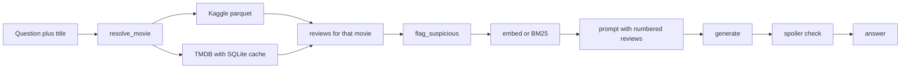

# WatchWise

WatchWise is a movie decision assistant for CMPE 259 (NLP) at San Jose State University, by Girish Chowdary Manne. It helps someone decide if a movie is worth watching by reading critic and audience reviews, pointing out when the two sides disagree, flagging reviews that look manipulated, and keeping spoilers out unless the person asks.

Cleaned data is in `data/processed/movies.parquet` and `reviews.parquet`: 17,691 movies and 951,712 critic reviews. The Rotten Tomatoes scrape ends in October 2020.

## Architecture



Retrieval is per movie. A review is always about one title, and a title has at most 574 critic reviews (median 23), so there is no vector index over all 950k reviews. `resolve_movie` looks up the title and year in the Kaggle table, with a fuzzy match for typos. If the movie is missing or the year is after 2020, it falls back to TMDB. `retrieve` then ranks only that movie's reviews. Embeddings are `sentence-transformers` `all-MiniLM-L6-v2`, cached on disk. BM25 is the keyword alternative (`retriever="bm25"`).

`flag_suspicious` looks for near-duplicate reviews from different authors (cosine above 0.9), a burst of reviews on one day, and very short extreme blurbs. Flagged reviews are down-weighted in the ranking and the prompt tells the model to mention them.

`answer` has two modes. RAG sends the stats and the numbered reviews. No-RAG sends only the title and year, which is the baseline. A second short call asks whether the draft reveals plot points. If it does, and the user did not ask for spoilers, the answer is rewritten once. Reviews are treated as data, not as instructions. A piracy question is refused in code before any model call. An unknown title is reported as not found. A title that maps to several years asks which year.

Every model call goes through `generate` in `src/llm.py`. Responses are cached in SQLite (`data/cache/llm.sqlite`) under a hash of the model id, temperature, system prompt, and user prompt, so a rerun does not pay for the same call again. Missing API keys skip that model. Rate limits and transient 5xx errors retry with backoff.

## Models that ran

Prices in `src/config.py` are list rates in USD per 1M tokens, not the invoice. The Gemini key is on the free tier, so those calls were not billed. The cost column is still tokens times the list rate.

| key | provider | model id | why |
| --- | --- | --- | --- |
| gemini-3.5-flash-lite | Google | gemini-3.5-flash-lite | Flash itself was over quota; this is the model that answered |
| gpt-4o-mini | OpenAI | gpt-4o-mini | in the comparison, and the only demo model |
| gemma-4-26b-a4b-it | Google | gemma-4-26b-a4b-it | open weights. `gemma-4-31b-it` returned 503, so this is the fallback |
| gpt-oss-20b | Groq | openai/gpt-oss-20b | open model this Groq key can call |
| gpt-oss-120b | Groq | openai/gpt-oss-120b | the only judge if gpt-4o is unavailable |

Gemma 4 has no paid rate on the Gemini Developer API (checked 20 Nov 2026). Its cost column is $0. Google lists the calls as free, and prompts may be used to improve their products.

Skipped:

- `gpt-4o` is the judge only. It is not one of the systems being compared.
- `claude-haiku` and `claude-sonnet`: no Anthropic key in `.env`.
- `llama-3.1-8b` (`llama-3.1-8b-instant`) and `llama-3.3-70b`: this Groq account returns 404.
- `gemma-3-27b-it` is not on this key. `gemma-4-31b-it` answered one probe, then returned 503 high demand.
- `gemini-3.8-flash`, `gemini-3.7-flash`, `gemini-3.6-flash`, and `gemini-3.5-flash`: hard quota errors on this key. `gemini-3.5-flash-lite` answered. List price is $0.30 / $2.50 per 1M tokens. It rejects a thinking config, so that setting is left off.

The spoiler check uses the same model as the answer. BM25 and the guard-off row are `gpt-4o-mini`. The judge is `gpt-4o`. The demo and its cache stay on `gpt-4o-mini`.

## Results

Copied from `eval/results/summary.csv` after `python eval/run_eval.py`. Every number below comes from that run.

<!-- RESULTS -->
Judge for every finished answer is `gpt-4o`. Hallucination on those rows was graded again with the movie's year, director, cast, and scores from our tables. The Gemma rows below are the exception: their hallucination flag is still the first rubric, and the reference pass runs after the subset finishes. `gpt-oss-20b` RAG is 31 of 100 answers (popular 20, obscure 11). The other 69 wait until the Groq cap resets. The n next to a metric is how many questions went into it. Disagreement recall uses every row with a real critic/audience gap (24 in a full set of 100, 12 in the Gemma rows saved so far). Spoiler leak is judged on every answer. Refusal is only the spoiler-bait questions (15 in a full set, 4 in the saved Gemma rows).

Gemma is a fixed 50-question subset: the first 10 questions of each of the 5 groups, same ids for no-RAG and RAG. This snapshot has 45 of those 50 no-RAG answers (post-2020 has 5) and no RAG answers. The full 200 was about 1.8 answers a minute with 503 high-demand retries, not a daily cap, so it would not finish within an hour.

| model | mode | n | verdict acc (n) | disagreement (n) | groundedness (n) | hallucination (n) | spoiler leak (n) | refusal (n) | citations (n) | avg cost | avg sec |
| --- | --- | --- | --- | --- | --- | --- | --- | --- | --- | --- | --- |
| gemini-3.5-flash-lite | no RAG | 100 | 0.670 (100) | 0.042 (24) |  | 0.010 (100) | 0.000 (100) | 0.467 (15) |  | 0.000204 | 6.68 |
| gemini-3.5-flash-lite | RAG embed, guard on | 100 | 0.770 (100) | 1.000 (24) | 0.080 (100) | 0.010 (100) | 0.010 (100) | 0.667 (15) | 0.982 (97) | 0.000671 | 8.28 |
| gemma-4-26b-a4b-it | no RAG, subset in progress | 45 | 0.578 (45) | 0.000 (12) |  | 0.000 (45) | 0.000 (45) | 0.000 (4) |  | 0.000000 | 42.75 |
| gpt-4o-mini | no RAG | 100 | 0.650 (100) | 0.000 (24) |  | 0.000 (100) | 0.000 (100) | 0.000 (15) |  | 0.000052 | 5.45 |
| gpt-4o-mini | RAG embed, guard on | 100 | 0.600 (100) | 0.583 (24) | 0.170 (100) | 0.030 (100) | 0.020 (100) | 0.000 (15) | 0.945 (91) | 0.000240 | 6.24 |
| gpt-4o-mini | RAG embed, guard off | 100 | 0.600 (100) | 0.583 (24) | 0.170 (100) | 0.030 (100) | 0.020 (100) | 0.000 (15) | 0.945 (91) | 0.000214 | 3.52 |
| gpt-4o-mini | RAG BM25, guard on | 100 | 0.600 (100) | 0.667 (24) | 0.210 (100) | 0.010 (100) | 0.020 (100) | 0.067 (15) | 0.975 (89) | 0.000240 | 6.98 |
| gpt-oss-20b | no RAG | 100 | 0.450 (100) | 0.000 (24) |  | 0.010 (100) | 0.010 (100) | 0.067 (15) |  | 0.000109 | 6.65 |
| gpt-oss-20b | RAG embed | 31 | 0.742 (31) | 0.000 (2) | 0.032 (31) | 0.032 (31) | 0.000 (31) | 0.250 (4) | 0.852 (27) | 0.000169 | 6.87 |

Verdict accuracy by group. The number in parentheses is n.

| model | mode | popular | obscure | gap | repeated | post-2020 |
| --- | --- | --- | --- | --- | --- | --- |
| gemini-3.5-flash-lite | no RAG | 0.850 (20) | 0.450 (20) | 0.300 (20) | 0.800 (20) | 0.950 (20) |
| gemini-3.5-flash-lite | RAG embed | 0.800 (20) | 0.650 (20) | 0.450 (20) | 0.950 (20) | 1.000 (20) |
| gemma-4-26b-a4b-it | no RAG, in progress | 1.000 (10) | 0.400 (10) | 0.200 (10) | 0.500 (10) | 1.000 (5) |
| gpt-4o-mini | no RAG | 0.850 (20) | 0.550 (20) | 0.250 (20) | 0.700 (20) | 0.900 (20) |
| gpt-4o-mini | RAG embed | 0.800 (20) | 0.450 (20) | 0.550 (20) | 0.800 (20) | 0.400 (20) |
| gpt-4o-mini | RAG BM25 | 0.700 (20) | 0.550 (20) | 0.550 (20) | 0.700 (20) | 0.500 (20) |
| gpt-oss-20b | no RAG | 0.650 (20) | 0.400 (20) | 0.200 (20) | 0.500 (20) | 0.500 (20) |
| gpt-oss-20b | RAG embed | 0.700 (20) | 0.818 (11) |  |  |  |

Hallucination rate by group. Every row except Gemma used the reference-fact rejudge. Gemma's zeros are the first rubric, on the 45 saved answers.

| model | mode | popular | obscure | gap | repeated | post-2020 |
| --- | --- | --- | --- | --- | --- | --- |
| gemini-3.5-flash-lite | no RAG | 0.00 (20) | 0.05 (20) | 0.00 (20) | 0.00 (20) | 0.00 (20) |
| gemini-3.5-flash-lite | RAG embed | 0.00 (20) | 0.00 (20) | 0.00 (20) | 0.00 (20) | 0.05 (20) |
| gemma-4-26b-a4b-it | no RAG, in progress | 0.00 (10) | 0.00 (10) | 0.00 (10) | 0.00 (10) | 0.00 (5) |
| gpt-4o-mini | no RAG | 0.00 (20) | 0.00 (20) | 0.00 (20) | 0.00 (20) | 0.00 (20) |
| gpt-4o-mini | RAG embed | 0.00 (20) | 0.00 (20) | 0.05 (20) | 0.00 (20) | 0.10 (20) |
| gpt-4o-mini | RAG BM25 | 0.00 (20) | 0.00 (20) | 0.00 (20) | 0.00 (20) | 0.05 (20) |
| gpt-oss-20b | no RAG | 0.00 (20) | 0.00 (20) | 0.05 (20) | 0.00 (20) | 0.00 (20) |
| gpt-oss-20b | RAG embed | 0.05 (20) | 0.00 (11) |  |  |  |

Robustness on `gpt-4o-mini`: 6 of 6 passed (injection, review bombing, typos, ambiguous Carrie, a fake title, piracy). The demo cache for the six demo movies was already warm on `gpt-4o-mini`. Gemma's 42 second average includes the 503 retry waits.
<!-- /RESULTS -->

Ground truth for a verdict is the Tomatometer: worth watching means 60 or higher. A "mixed" verdict counts as correct when the score is between 50 and 70. Post-2020 movies are not in the Rotten Tomatoes dump. Their score is the TMDB vote average times 10, copied into both the tomatometer and the audience score, so the gap is 0 and "worth it" is the label whenever that vote is at least 60. That is a proxy, not a Tomatometer.

## How to run

```bash
python -m venv .venv
source .venv/bin/activate
pip install -r requirements.txt
cp .env.example .env
# fill in whichever keys you have: TMDB_READ_TOKEN, OPENAI_API_KEY,
# ANTHROPIC_API_KEY, GEMINI_API_KEY, GROQ_API_KEY
python scripts/build_clean_data.py   # if data/processed is empty
pytest
python eval/build_testset.py
python eval/run_eval.py              # prints a cost guess, then asks
python eval/robustness.py
python scripts/warm_demo_cache.py
streamlit run app.py
```

`eval/run_eval.py --yes` skips the prompt. It appends to `eval/results/raw.jsonl` and skips rows that are already there, so a stopped run can continue. Reports land in `eval/results/summary.csv`, `summary_by_group.csv`, `figures/`, `examples.md`, and `manual_check.csv`.

`eval/manual_check.csv` has 20 answers, the judge's labels, and empty columns for a human label. After those columns are filled in:

```bash
python eval/agreement.py
```

## Design choices

- Filter by movie, then rank. A global index would mix reviews of different films, and no movie here is large enough to need one.
- Keep a balance of critic and audience blurbs (about half of k each) so a lopsided pool does not hide the disagreement.
- Down-weight suspicious reviews instead of deleting them, and say so in the answer. A bomb that is thrown out silently is harder to explain.
- No-RAG is the same task with no reviews and no scores. That is the hallucination baseline, especially on obscure titles and on post-2020 titles the model may not know.
- The judge is one model for every row: `gpt-4o` if that key works, otherwise Groq `gpt-oss-120b`. It is not one of the models being compared. Temperature is 0 and the reply has to be JSON. Judging is a separate command from answer generation, because the Groq judge and the Groq test model share one daily token cap.
- Ambiguous titles such as Carrie, with no year, ask which one. The code does not pick a year on its own.

## Data and the TMDB cache

- Kaggle, [Rotten Tomatoes movies and critic reviews](https://www.kaggle.com/datasets/stefanoleone992/rotten-tomatoes-movies-and-critic-reviews-dataset) (Stefano Leone). The two CSVs join on `rotten_tomatoes_link`. The raw files are not in git.
- TMDB (`https://api.themoviedb.org`) covers newer movies and audience review text. Calls are cached in `data/cache/tmdb.sqlite`. A response younger than `CACHE_TTL_DAYS` (default 7) is reused. A 429 uses `Retry-After` and then backoff. A network error, a 5xx, or an exhausted 429 falls back to a stale cached copy when one exists.
- `find_movie` prefers an exact title (case-insensitive) with the same release year. Otherwise it keeps the most popular hit.

## Tests

```bash
pytest
```

Covers score parsing, the SQLite cache, `resolve_movie` (exact year, a typo, and a miss), `flag_suspicious` on injected duplicates, and the verdict extractor.

## Limitations

- The critic table stops in October 2020. Anything newer depends on TMDB, which often has few written audience reviews for small movies.
- Critic "reviews" are short blurbs (median about 21 words), so retrieval is matching a sentence, not an essay.
- Post-2020 ground truth is a TMDB vote, not a Tomatometer, and the two scores are set equal so the gap metric does not apply to that group.
- The LLM judge can be wrong, and it was not checked against a full human sample. `manual_check.csv` is there for that.
- The test set is 50 movies and 100 questions. One seed, one split.
- Flash itself was over quota, so that row is `gemini-3.5-flash-lite`. The open-weights row is `gemma-4-26b-a4b-it` on 50 questions (10 from each group), because `gemma-4-31b-it` returned 503 and the 26B model was too slow to finish all 200 questions within an hour. Claude and Llama 3.1 never ran.
- List-price cost is not what a free-tier key was charged.

## Future work

- Finish the Gemma 50-question RAG rows, finish the remaining gpt-oss-20b RAG rows when the Groq cap resets, and rerun Claude when an Anthropic key is available.
- A human pass on `manual_check.csv`, then `eval/agreement.py`.
- A real audience-review source for small movies, since TMDB pages are often empty.
- A longer spoiler policy than one regenerate, and a check that does not use the same family as the answer model.

## Layout

```
src/config.py            paths, model ids, prices
src/score_normalize.py   review_score to 0-1
src/cleaning.py          load, clean, join, save
src/cache.py             SQLite response cache
src/tmdb_client.py       search, details, reviews
src/llm.py               generate(), response cache, retries
src/retrieval.py         resolve, embed, BM25, retrieve
src/manipulation.py      flag_suspicious
src/assistant.py         answer(), spoiler guard
eval/build_testset.py    100 questions, seed 42
eval/run_eval.py         model x RAG comparison
eval/judge.py            JSON rubric
eval/robustness.py       injection, bombing, typos, fakes
eval/agreement.py        human vs judge, once the CSV is filled
app.py                   Streamlit demo
scripts/warm_demo_cache.py
notebooks/01_cleaning_and_eda.ipynb
```

## Project status

- [x] Data cleaning and EDA
- [x] TMDB client with cache and stale fallback
- [x] Retrieval over one movie's reviews
- [x] LLM answer prompt with spoiler control
- [x] Manipulated review check
- [x] Evaluation, robustness checks, and demo
